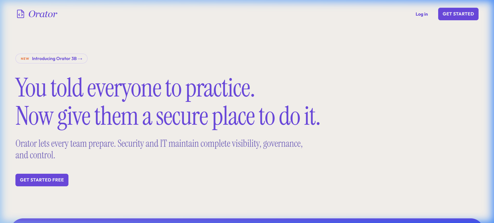
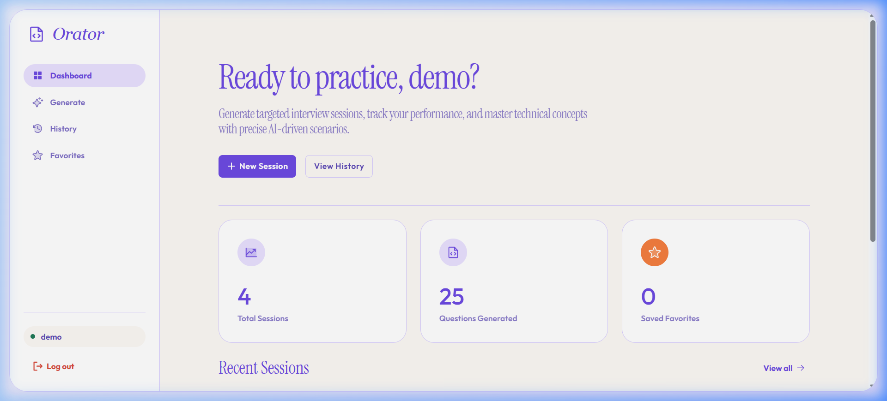
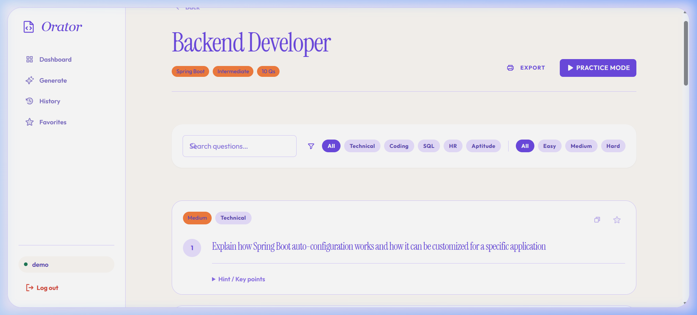
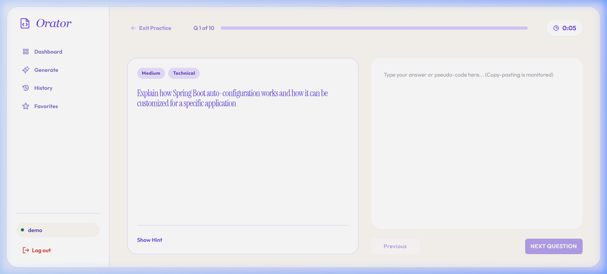

<p align="center">
  <h1 align="center">Orator 🎙️</h1>
</p>

<p align="center">
  <a href="https://orator-ai.vercel.app">Live Demo</a> | <a href="https://github.com/h55n/orator">GitHub Repo</a> | <a href="#-setup-instructions">Installation</a>
</p>

<p align="center">
  
  
  
  
  
  
</p>

<p align="center">
  <strong>The AI-Powered Interview Question Generator.</strong> Built to dynamically generate targeted interview questions, assess your answers in real-time, and catch cheating attempts using Llama 3.
</p>

> **Submitted for:** Nexoraa Technosolve IT Services Pvt. Ltd. — Java Full Stack Developer Technical Assessment  
> **Submission Deadline:** 07 August 2026

---

## 🎥 App Demonstration


---

## 👤 Author

| Field   | Details                        |
|---------|-------------------------------|
| **Name**    | Hassan Rehman           |
| **Phone**   | +91-8482984869       |
| **Email**   | hassan0rehman@gmail.com           |
| **Website** | orator-ai.vercel.app  |
| **GitHub**  | [https://github.com/h55n/orator] |

---

## 📌 Project Overview

**Orator** is a full-stack web application that generates AI-driven, targeted interview questions based on a user's selected job role, technology, and experience level. The application goes well beyond the base requirements — it features a polished editorial UI design system, AI-powered self-assessment with cheating detection, practice mode with real-time timers, and a robust Spring Boot REST API secured with JWT authentication.

> Built with Java 17, Spring Boot 3.2, React 18, Vite, PostgreSQL, and free AI APIs (GROQ / NVIDIA NIM).

---

## 🎯 What Was Required vs. What Was Delivered

### ✅ All Required Features (From the Assessment Brief)

| Requirement | Status |
|---|---|
| User Registration & Login | ✅ Implemented with JWT + BCrypt |
| Select Job Role | ✅ Dropdown with 15 role options |
| Select Technology/Skill | ✅ Dropdown with 25 technology options |
| Select Experience Level (Fresher / Intermediate / Experienced) | ✅ Toggle chip selector |
| Generate Interview Questions | ✅ AI-generated via GROQ Llama3 / NVIDIA NIM |
| Categorize Questions (Technical, Coding, SQL, HR, Aptitude) | ✅ Multi-select with per-category distribution |
| Difficulty Levels (Easy, Medium, Hard) | ✅ ~30% Easy / 45% Medium / 25% Hard |
| Search and Filter Questions | ✅ Keyword search + category + difficulty filters |
| Save Favorite Questions | ✅ Star/unstar per question, paginated favorites page |
| View Previously Generated Questions (History) | ✅ Paginated session history with delete |
| RESTful APIs using Spring Boot | ✅ 12+ endpoints, all documented below |
| Responsive User Interface using React.js | ✅ Mobile-first, sidebar collapses on mobile |
| Database integration | PostgreSQL through JPA/Hibernate; legacy MySQL schema retained for reference |
| Proper Exception Handling and Input Validation | ✅ GlobalExceptionHandler + Bean Validation |

### 🚀 Extra Features Added Beyond Requirements

| Extra Feature | Description |
|---|---|
| **Practice Mode** | Full-screen timed interview simulation with per-question timer |
| **AI Self-Assessment** | Submit answers and receive per-question AI scoring (0–10) with detailed written feedback |
| **AI Cheating Detection** | Detects AI-generated or copy-pasted answers with flag + reasoning displayed on results |
| **Paste Monitoring** | Paste events blocked in practice mode and counted for assessment scoring |
| **Tab-Switch Detection** | Tracks tab switches during practice and factors them into assessment |
| **Demo Login** | One-click demo access without registration |
| **Export to PDF** | Browser print-to-PDF with clean print stylesheet |
| **Copy Question Button** | One-click copy for any question |
| **Orator Design System** | Full editorial design system: Instrument Serif + Outfit fonts, purple palette, floating app shell |
| **Landing Page** | Marketing-grade landing page with hero, feature cards, and footer |
| **Session Score Display** | Overall AI score shown on history cards and dashboard recent sessions |
| **Docker Compose** | One-command `docker-compose up` for full local stack |
| **Animated UI** | Stagger animations, fade-up cards, hover micro-interactions |

---

## 🏗️ Architecture Overview

```
┌─────────────────────────────────────────────────────────────────────┐
│                         BROWSER (React 18 + Vite)                   │
│                                                                       │
│  ┌─────────────┐  ┌──────────────┐  ┌──────────────┐  ┌──────────┐  │
│  │ LandingPage │  │ Auth Pages   │  │ App Layout   │  │ Pages    │  │
│  │             │  │ Login /      │  │ (Sidebar +   │  │ Dashboard│  │
│  │ Marketing   │  │ Register     │  │ Protected    │  │ Generate │  │
│  │ Hero        │  │ Demo Login   │  │ Routes)      │  │ Session  │  │
│  └─────────────┘  └──────────────┘  └──────────────┘  │ History  │  │
│                                                         │ Favorites│  │
│                    ┌─────────────────────────────────┐  └──────────┘  │
│                    │         services/api.js          │               │
│                    │  axios + JWT interceptor         │               │
│                    │  authService | questionService   │               │
│                    │  favoriteService | referenceService              │
│                    └───────────────┬─────────────────┘               │
└────────────────────────────────────┼────────────────────────────────┘
                                     │ HTTP/REST (JWT Bearer)
                    ┌────────────────▼─────────────────┐
                    │      Spring Boot 3.2 Backend       │
                    │                                    │
                    │  ┌──────────┐  ┌───────────────┐  │
                    │  │Security  │  │  Controllers  │  │
                    │  │Config    │  │  Auth         │  │
                    │  │JWT Filter│  │  Question     │  │
                    │  │BCrypt    │  │  Favorite     │  │
                    │  └──────────┘  │  Reference    │  │
                    │                └───────┬───────┘  │
                    │  ┌─────────────────────▼───────┐  │
                    │  │          Services            │  │
                    │  │  AuthService                │  │
                    │  │  QuestionService             │  │
                    │  │  FavoriteService             │  │
                    │  │  AiClient  ←──────────────┐  │  │
                    │  │  PromptBuilder             │  │  │
                    │  └─────────────────────────────┘  │
                    │                                    │
                    │  ┌──────────────┐                  │
                    │  │  JPA Repos   │                  │
                    │  │  UserRepo    │                  │
                    │  │  SessionRepo │                  │
                    │  │  QuestionRepo│                  │
                    │  │  FavoriteRepo│                  │
                    │  └──────┬───────┘                  │
                    └─────────┼──────────────────────────┘
                              │ JDBC
                    ┌─────────▼──────────┐     ┌──────────────────────┐
                    │    PostgreSQL       │     │   GROQ API           │
                    │  interviewgen_db    │     │   (llama-3.3-70b)    │
                    │                    │     │   OR                  │
                    │  users             │     │   NVIDIA NIM          │
                    │  generation_sessions│     │   (llama-3.1-70b)    │
                    │  questions         │     └──────────────────────┘
                    │  user_favorites    │
                    └────────────────────┘
```

---

## 🏛️ Technology Stack

| Layer | Technology | Details |
|---|---|---|
| **Backend** | Java 17, Spring Boot 3.2 | REST API, Security, Validation |
| **Auth** | Spring Security + JWT (jjwt 0.12.5) + BCrypt | Stateless JWT, 24h expiry |
| **AI Provider** | GROQ API (free) or NVIDIA NIM (free credits) | OpenAI-compatible `/v1/chat/completions` |
| **Frontend** | React 18, Vite, React Router v6 | SPA with protected routes |
| **Styling** | Tailwind CSS v3 + Custom CSS Design System | Instrument Serif + Outfit fonts |
| **Icons** | Phosphor Icons for React | Duotone icon set |
| **HTTP Client (FE)** | Axios | JWT interceptor, 401 auto-redirect |
| **HTTP Client (BE)** | Spring WebFlux WebClient | Non-blocking AI API calls |
| **Database** | PostgreSQL 16 | PostgreSQL JDBC driver; tables managed by Hibernate |
| **ORM** | Spring Data JPA + Hibernate | `ddl-auto=update` |
| **Containerization** | Docker + Docker Compose | PostgreSQL + backend orchestrated |
| **Build Tool** | Maven 3.8+ | Spring Boot Maven Plugin |
| **Version Control** | Git + GitHub | Public repository |

---

## ✨ Feature Deep Dive

### 1. Authentication System
- JWT-based stateless authentication (24-hour tokens)
- BCrypt password hashing (Spring Security default strength)
- Auto-redirect to `/login` on 401 responses
- Persistent login via `localStorage` with server-side token validation on mount
- Demo login endpoint creates/reuses a shared demo account
- `AuthProvider` context hook (`useAuth`) wraps the entire app

### 2. AI Question Generation
The `PromptBuilder` service constructs highly structured prompts engineered for consistency across any LLM:
- **Role-primed system prompt** — model positioned as "senior technical interviewer with 15+ years experience"
- **Explicit JSON schema** — forces structured output with exact field names
- **Per-category distribution rules** — Technical, Coding, SQL, HR, Aptitude with specific guidelines
- **Experience calibration blocks** — Fresher / Intermediate / Experienced guidance
- **Difficulty anchoring** — Easy (recall), Medium (application), Hard (design/optimisation)
- **Anti-hallucination guardrails** — no filler, no duplicates, real-world relevance
- **Markdown fence handling** — `extractJson()` strips any accidental markdown from AI output

### 3. Practice Mode
A full-screen interview simulation environment:
- Real-time countdown timer per session
- One question displayed at a time with previous/next navigation
- Paste detection — blocked with warning toast, paste count recorded
- Tab-switch detection via `visibilitychange` API
- Hint reveal toggle (so you can check if needed)
- Progress bar showing completion percentage
- Submit Assessment button on final question

### 4. AI Self-Assessment
After practice mode submission:
- All answers sent to backend with paste count + tab switch metadata
- `PromptBuilder.buildAssessmentUserPrompt()` passes full Q&A context to AI
- AI returns: overall score (0–100), overall feedback, per-question score (0–10), detailed feedback
- AI flags answers that appear generated or copy-pasted (`isAiGenerated: true`) with reasoning
- Results persist in `generation_sessions.assessment_data` (JSON) and show on history cards

### 5. Session History & Favorites
- Paginated session list (10 per page) with delete capability
- Sessions show: job role, technology, experience level, category chips, question count, date, AI score
- Questions within sessions can be individually starred (saved to favorites)
- Favorites page shows all starred questions with search, pagination, and one-click remove
- Favorites persisted in `user_favorites` join table with unique constraint

---

## 📁 Project Structure

```
orator/
├── backend/
│   ├── Dockerfile
│   ├── pom.xml
│   └── src/main/
│       ├── java/com/nexoraa/interviewgen/
│       │   ├── InterviewGenApplication.java
│       │   ├── config/
│       │   │   └── AppConfig.java              ← ObjectMapper + WebClient beans
│       │   ├── controller/
│       │   │   ├── AuthController.java
│       │   │   ├── QuestionController.java
│       │   │   ├── FavoriteController.java
│       │   │   └── ReferenceController.java
│       │   ├── dto/
│       │   │   └── Dto.java                    ← All nested static DTOs
│       │   ├── entity/
│       │   │   ├── User.java
│       │   │   ├── GenerationSession.java
│       │   │   ├── Question.java
│       │   │   └── UserFavorite.java
│       │   ├── exception/
│       │   │   ├── AppException.java
│       │   │   └── GlobalExceptionHandler.java
│       │   ├── repository/
│       │   │   ├── UserRepository.java
│       │   │   ├── GenerationSessionRepository.java
│       │   │   ├── QuestionRepository.java
│       │   │   └── UserFavoriteRepository.java
│       │   ├── security/
│       │   │   ├── SecurityConfig.java         ← CORS, JWT filter chain
│       │   │   └── JwtUtil.java
│       │   └── service/
│       │       ├── AuthService.java
│       │       ├── QuestionService.java
│       │       ├── FavoriteService.java
│       │       ├── AiClient.java               ← GROQ/NVIDIA WebClient calls
│       │       └── PromptBuilder.java          ← Prompt engineering
│       └── resources/
│           └── application.properties
│
├── frontend/
│   ├── index.html
│   ├── package.json
│   ├── vite.config.js
│   ├── tailwind.config.js
│   └── src/
│       ├── App.jsx                             ← Router + protected routes
│       ├── main.jsx
│       ├── components/layout/
│       │   ├── AppLayout.jsx                  ← Sidebar shell
│       │   ├── AppLayout.css
│       │   └── Footer.jsx
│       ├── hooks/
│       │   └── useAuth.jsx                    ← AuthContext + AuthProvider
│       ├── pages/
│       │   ├── LandingPage.jsx
│       │   ├── LoginPage.jsx
│       │   ├── RegisterPage.jsx
│       │   ├── DashboardPage.jsx
│       │   ├── GeneratePage.jsx
│       │   ├── SessionPage.jsx                ← Review + Practice + Assessment
│       │   ├── HistoryPage.jsx
│       │   └── FavoritesPage.jsx
│       ├── services/
│       │   └── api.js                         ← All API calls + axios instance
│       └── styles/
│           ├── design-tokens.css              ← CSS custom properties
│           └── global.css                     ← Base styles + component classes
│
├── docs/
│   ├── schema.sql
│   ├── CLAUDE_CODE_PROMPT.md
│   └── README.md
├── docker-compose.yml
├── .gitignore
└── orator-design.md                           ← Design system specification
```

---

## 🗄️ Database Schema

```sql
-- Users table
users (
  id          BIGINT AUTO_INCREMENT PRIMARY KEY,
  name        VARCHAR(100) NOT NULL,
  email       VARCHAR(255) NOT NULL UNIQUE,
  password    VARCHAR(255) NOT NULL,          -- BCrypt hash
  is_active   TINYINT(1) DEFAULT 1,
  created_at  DATETIME DEFAULT CURRENT_TIMESTAMP,
  updated_at  DATETIME ON UPDATE CURRENT_TIMESTAMP
)

-- Generation sessions (one per "Generate" button click)
generation_sessions (
  id               BIGINT AUTO_INCREMENT PRIMARY KEY,
  user_id          BIGINT NOT NULL → users(id) CASCADE DELETE,
  job_role         VARCHAR(100) NOT NULL,
  technology       VARCHAR(100) NOT NULL,
  experience_level VARCHAR(50) NOT NULL,
  categories       VARCHAR(255) NOT NULL,    -- CSV: "Technical,Coding,HR"
  question_count   INT DEFAULT 0,
  created_at       DATETIME DEFAULT CURRENT_TIMESTAMP,
  assessment_data  TEXT                       -- JSON blob from AI assessment
)

-- Individual questions (children of sessions)
questions (
  id               BIGINT AUTO_INCREMENT PRIMARY KEY,
  session_id       BIGINT NOT NULL → generation_sessions(id) CASCADE DELETE,
  question         TEXT NOT NULL,
  hint             TEXT,
  category         VARCHAR(50) NOT NULL,      -- Technical|Coding|SQL|HR|Aptitude
  difficulty       VARCHAR(20) NOT NULL,      -- Easy|Medium|Hard
  job_role         VARCHAR(100),
  technology       VARCHAR(100),
  experience_level VARCHAR(50),
  created_at       DATETIME DEFAULT CURRENT_TIMESTAMP,
  FULLTEXT INDEX ft_questions_text (question)
)

-- Favorites (many-to-many: users ↔ questions)
user_favorites (
  id          BIGINT AUTO_INCREMENT PRIMARY KEY,
  user_id     BIGINT NOT NULL → users(id) CASCADE DELETE,
  question_id BIGINT NOT NULL → questions(id) CASCADE DELETE,
  created_at  DATETIME DEFAULT CURRENT_TIMESTAMP,
  UNIQUE KEY uq_user_question (user_id, question_id)
)
```

---

## 📡 API Endpoints

### Auth
| Method | Endpoint | Auth | Description |
|---|---|---|---|
| `POST` | `/api/auth/register` | ❌ | Register new user → returns JWT + user |
| `POST` | `/api/auth/login` | ❌ | Login → returns JWT + user |
| `POST` | `/api/auth/demo` | ❌ | Demo login (auto-creates demo account) |
| `GET` | `/api/auth/me` | ✅ | Get current user profile |

### Questions
| Method | Endpoint | Auth | Description |
|---|---|---|---|
| `POST` | `/api/questions/generate` | ✅ | Generate AI questions, persist session |
| `GET` | `/api/questions/history?page=0&size=10` | ✅ | Paginated session history |
| `GET` | `/api/questions/session/{id}` | ✅ | Full session with all questions |
| `DELETE` | `/api/questions/session/{id}` | ✅ | Delete session (cascade deletes questions + favorites) |
| `POST` | `/api/questions/session/{id}/assess` | ✅ | Submit answers for AI assessment |
| `GET` | `/api/questions/search?keyword=&category=&difficulty=&technology=` | ✅ | Search/filter across all user's questions |

### Favorites
| Method | Endpoint | Auth | Description |
|---|---|---|---|
| `POST` | `/api/favorites/{questionId}` | ✅ | Add question to favorites |
| `DELETE` | `/api/favorites/{questionId}` | ✅ | Remove from favorites |
| `GET` | `/api/favorites?page=0&size=20` | ✅ | Get paginated favorites list |

### Reference Data
| Method | Endpoint | Auth | Description |
|---|---|---|---|
| `GET` | `/api/reference/job-roles` | ✅ | Get list of available job roles |
| `GET` | `/api/reference/technologies` | ✅ | Get list of available technologies |

---

## 🎨 Design System — Orator Editorial

The frontend uses a custom design system inspired by Tines' editorial aesthetic:

| Token | Value |
|---|---|
| **Primary** | `#6D4AE3` (brand purple) |
| **Primary 60** | `#8D75E6` (lighter lavender) |
| **Primary 20** | `#E9E1FF` (pale lilac, chips/backgrounds) |
| **Secondary** | `#F47E3F` (orange accent — used sparingly) |
| **Tertiary** | `#5F3FC4` (deeper violet, hover states) |
| **Neutral** | `#FCF9F5` (warm off-white page background) |
| **Surface** | `#FFFFFF` (card backgrounds) |
| **On-Surface** | `#5B47B6` (purple-toned text) |
| **Border** | `#D7CCFF` (lavender borders) |
| **Success** | `#1F7A57` |
| **Error** | `#D94C3D` |
| **Display Font** | Instrument Serif (italic, editorial headlines) |
| **Body Font** | Outfit (300–700, clean geometric sans) |

The app shell is a **floating card** design — a centered rounded container (`border-radius: 32px`) with a subtle purple gradient background, giving a polished SaaS feel.

---

## 🚀 Setup Instructions

### Prerequisites
- Java 17+
- Node.js 22+
- PostgreSQL 16 (or Docker with Compose v2)
- Maven 3.8+
- A GROQ API key only when using AI generation; auth and history can run without it

### Option A - Docker Compose

```bash
git clone https://github.com/h55n/orator.git
cd orator

# Set private values in your local environment. Do not commit them.
export JWT_SECRET="$(openssl rand -base64 64 | tr -d '\n')"
export POSTGRES_PASSWORD="$(openssl rand -hex 32)"
# Optional for AI generation:
# export GROQ_API_KEY=...

docker compose up -d --build
cd frontend
npm ci
npm run dev
```

Open http://localhost:3000. The backend is published at http://localhost:8080,
mapped to its container listener on port 7860. PostgreSQL is internal to the Compose
network and is not published on the host. Hibernate creates the PostgreSQL tables.

This uses a new `postgres_data` volume. The old MySQL volume is not reused or
migrated, and the legacy `docs/schema.sql` is MySQL-only. Keep existing data backed
up and plan a migration separately; do not run `docker compose down --volumes`
against a database you need to keep.

### Option B - Manual Setup

Create a PostgreSQL database and role using your local PostgreSQL administration
account, then provide their details to the backend through environment variables:

```bash
export DATABASE_URL=jdbc:postgresql://localhost:5432/interviewgen_db
export DATABASE_USERNAME=orator
# Set DATABASE_PASSWORD to the password for your local database role.
export JWT_SECRET="$(openssl rand -base64 64 | tr -d '\n')"
export SERVER_PORT=8080
# Optional: export GROQ_API_KEY=...
cd backend
mvn spring-boot:run
```

With `SERVER_PORT=8080`, the backend matches the frontend development proxy.
Without that override, the backend's default port is 7860.

#### Step 4: Run Frontend
```bash
cd frontend
npm install
npm run dev
# Runs at http://localhost:3000
```

---

## 🔑 Getting Free AI API Keys

### GROQ (Recommended — Fastest, Completely Free)
1. Sign up at [https://console.groq.com](https://console.groq.com)
2. Create an API key (no credit card required)
3. Set in `application.properties`:
   ```properties
   ai.provider=groq
   ai.groq.api-key=gsk_xxxxx
   ai.groq.model=llama-3.3-70b-versatile
   ```
4. Free tier: 14,400 requests/day, 6,000 tokens/minute

### NVIDIA NIM (Alternative — Free Credits)
1. Sign up at [https://build.nvidia.com](https://build.nvidia.com)
2. Receive $25 free inference credits
3. Set in `application.properties`:
   ```properties
   ai.provider=nvidia
   ai.nvidia.api-key=nvapi_xxxxx
   ai.nvidia.model=meta/llama-3.1-70b-instruct
   ```

---

## 🔄 Application Flow

```
User visits / → Landing Page
                    ↓
             Register / Login
                    ↓
              Dashboard
              (stats + recent sessions)
                    ↓
            Generate Page
            (select role, tech, level, categories, count)
                    ↓
           AI generates questions
           (PromptBuilder → AiClient → GROQ/NVIDIA)
                    ↓
            Session Page (Review Mode)
            - Browse questions
            - Filter by category/difficulty
            - Search
            - Star favorites
            - Export to PDF
                    ↓
            Practice Mode (optional)
            - Timer starts
            - Type answers (paste blocked)
            - Tab switches tracked
                    ↓
            Submit Assessment
            - AI scores each answer 0-10
            - Flags AI-generated responses
            - Overall score 0-100
            - Detailed feedback per question
                    ↓
            Results saved to session
            Score appears in History
```

---

## 🛡️ Security Implementation

- **Password storage:** BCrypt hashing via Spring Security's `BCryptPasswordEncoder`
- **Authentication:** JWT signed with HMAC-SHA256 using a 256-bit Base64-encoded secret
- **Authorization:** `JwtAuthFilter` (extends `OncePerRequestFilter`) validates token on every request
- **Stateless:** `SessionCreationPolicy.STATELESS` — no server-side sessions
- **CORS:** Configured via `CorsConfigurationSource` bean, restricted to `localhost:3000` and `localhost:5173`
- **Input Validation:** Jakarta Bean Validation (`@NotBlank`, `@Email`, `@Min`, `@Max`, `@Pattern`) on all DTOs
- **Error handling:** `GlobalExceptionHandler` with `@RestControllerAdvice` catches `AppException`, validation errors, and generic exceptions — never leaks stack traces to client
- **Data isolation:** All queries filter by `user_id` extracted from JWT — users can never access other users' data

---

## 📋 Sample Request / Response

### Generate Questions
```json
POST /api/questions/generate
Authorization: Bearer <token>
{
  "jobRole": "Backend Developer",
  "technology": "Spring Boot",
  "experienceLevel": "Intermediate",
  "categories": ["Technical", "Coding", "SQL"],
  "questionCount": 10
}

Response 201:
{
  "sessionId": 42,
  "questions": [
    {
      "id": 101,
      "question": "Explain the difference between @RestController and @Controller in Spring Boot. When would you use each?",
      "hint": "• @RestController = @Controller + @ResponseBody • Use @Controller for MVC views, @RestController for REST APIs • Response body serialization difference",
      "category": "Technical",
      "difficulty": "Medium",
      "technology": "Spring Boot",
      "jobRole": "Backend Developer",
      "experienceLevel": "Intermediate",
      "isFavorite": false
    }
  ]
}
```

---

## 🐳 Docker Support

The backend Dockerfile and Compose file provide a local PostgreSQL deployment.
Set `JWT_SECRET` and `POSTGRES_PASSWORD` before starting it (see setup above).

```bash
docker compose up -d --build
# Backend: http://localhost:8080
# PostgreSQL: internal service only, no published database port
```

The `Disposable Compose deployment` CI workflow builds the actual image and uses
a fresh database volume to verify startup, registration, login, profile retrieval,
empty history, and persisted hashed passwords. It makes no AI generation requests.

> Note: Frontend is not containerized (runs via `npm run dev` for development). For production, build with `npm run build` and serve the `dist/` directory.

---

## 📸 Application Screenshots

### Landing Page


### Dashboard


### Session Review & Feedback


### Practice Mode


| Page | Description |
|---|---|
| Landing Page | Marketing page with hero, features, and CTA |
| Login / Register | Auth cards with demo login option |
| Dashboard | Stats (sessions, questions, favorites) + recent sessions |
| Generate Page | Configuration form with all selectors and sliders |
| Session — Review Mode | Question grid with filters, search, favorites, export |
| Session — Practice Mode | Full-screen timed mode with answer input |
| Session — Assessment Results | AI score ring, overall feedback, per-question breakdown |
| History Page | Paginated session list with AI scores and delete |
| Favorites Page | Saved questions grid with search |

---

## ⚠️ Known Limitations & Notes

- The AI generation timeout is set to **55 seconds** — large question counts (25+) may occasionally approach this limit on free GROQ tier
- The `assessment_data` column stores the full AI assessment as a JSON string in the `TEXT` column — suitable for the scale of this application
- CORS is currently configured for localhost origins only; update `app.cors.allowed-origins` for production deployment
- The JWT secret in `application.properties` should **never** be committed to a public repository in production — use environment variables

---

## 📄 License

This project was built as a technical assessment submission for Nexoraa Technosolve IT Services Pvt. Ltd. and is not licensed for commercial use.

---

*Built with ❤️ using Java Spring Boot, React.js, and free AI APIs.*

### JWT signing key required

Set `JWT_SECRET` in the backend environment before starting it or Docker Compose.
Use a private Base64-encoded random key containing at least 32 decoded bytes.
There is no default key. Missing, malformed or short keys stop backend startup.
Do not put the key in frontend environment files, source control or logs.

The previous repository key was public. Any deployment that used it must replace
it; changing the key invalidates existing login tokens. This source change does
not rotate a deployed secret or remove it from Git history.
